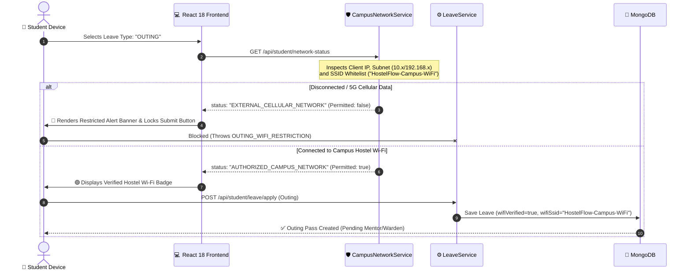
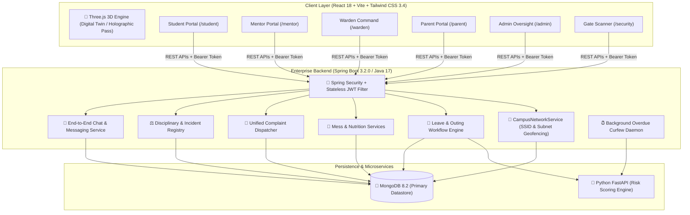

<div align="center">

# 🏨 HostelFlow AI
### Autonomous Campus Living & Student Governance Platform

> **Full-Stack Enterprise System** — Java 17 Spring Boot · React 18 · Three.js 3D WebGL · MongoDB · FastAPI AI · Tailwind CSS 3.4 · Docker

[](https://openjdk.org/)
[](https://spring.io/projects/spring-boot)
[](https://react.dev/)
[](https://threejs.org/)
[](https://www.mongodb.com/)
[](https://tailwindcss.com/)
[](LICENSE)

<br/>

```
  ██   ██  ██████  ███████ ████████ ███████ ██      ███████ ██       ██████  ██     ██     █████  ██ 
  ██   ██ ██    ██ ██         ██    ██      ██      ██      ██      ██    ██ ██     ██    ██   ██ ██ 
  ███████ ██    ██ ███████    ██    █████   ██      █████   ██      ██    ██ ██  █  ██    ███████ ██ 
  ██   ██ ██    ██      ██    ██    ██      ██      ██      ██      ██    ██ ██ ███ ██    ██   ██ ██ 
  ██   ██  ██████  ███████    ██    ███████ ███████ ██      ███████  ██████   ███ ███     ██   ██ ██ 
```
*Next-generation institutional hostel operations, geofenced security, and student welfare management.*

</div>

---

## 📑 Table of Contents

- [🌟 Platform Overview](#-platform-overview)
- [✨ Key Innovations](#-key-innovations)
  - [📶 Campus Wi-Fi Outing Verification](#-campus-wi-fi-outing-verification-geofence)
  - [🧊 3D WebGL Digital Twin & Holographic Pass](#-3d-webgl-digital-twin--holographic-pass)
  - [🛡️ Unified Multi-Role Governance Engine](#-unified-multi-role-governance-engine)
- [🏛️ System Architecture](#-system-architecture)
- [👥 Role-Based Portals](#-role-based-portals)
  - [1. Student Portal](#1-student-portal-student)
  - [2. Mentor Portal](#2-mentor-portal-mentor)
  - [3. Warden Operations Command](#3-warden-operations-command-warden)
  - [4. Parent Portal](#4-parent-portal-parent)
  - [5. Institutional Admin Portal](#5-institutional-admin-portal-admin)
  - [6. Security Gate Kiosk](#6-security-gate-kiosk-security)
- [🔄 Core Operational Workflows](#-core-operational-workflows)
- [🚀 Quick Start Guide](#-quick-start-guide)
  - [Option A: One-Command Local Launch](#option-a-one-command-local-launch-recommended)
  - [Option B: Docker Compose](#option-b-docker-compose)
- [🔑 Pre-Seeded Test Credentials](#-pre-seeded-test-credentials)
- [📡 API Reference Summary](#-api-reference-summary)
- [📊 Project Report Blueprint](#-project-report-blueprint)

---

## 🌟 Platform Overview

**HostelFlow AI** eliminates traditional paper logbooks, unverified leave passes, and fragmented hostel communication. Designed for university campuses and boarding institutions hosting 500 to 10,000+ residents, it connects students, faculty mentors, wardens, parents, and security guards into one unified real-time ecosystem.

### Core Objectives
1. **Physical Presence Verification**: Eliminates proxy submissions by verifying that short-term outing requests originate from the designated college hostel Wi-Fi network.
2. **End-to-End Governance**: Bridges student needs (mess complaints, maintenance, room swaps, laundry) with warden dispatchers and real-time parent notifications.
3. **Immersive Digital Twin**: Visualizes hostel blocks, floor occupancy heatmaps, and digital holographic gate passes using hardware-accelerated 3D WebGL (Three.js).
4. **Predictive Risk & Automated Curfew Tracking**: Background daemons monitor expected return times, flag overdue students, and alert mentors/parents automatically without human lag.

---

## ✨ Key Innovations

### 📶 Campus Wi-Fi Outing Verification (Geofence)
To prevent students from submitting outing passes after already sneaking off campus or having friends submit proxies, HostelFlow AI enforces institutional network verification:



- **Interactive Test Simulator**: A built-in simulator toggle on `/student/apply` lets testers and evaluators toggle between `[📶 Hostel Wi-Fi (Permitted)]` and `[📱 5G Mobile Data (Blocked)]` with live UI feedback.

---

### 🧊 3D WebGL Digital Twin & Holographic Pass
- **`Campus3DView.jsx`**: Real-time 3D isometric model of hostel blocks (Block A, Block B, Mess Hall, Sports Ground) with occupancy heatmaps and interactive raycasting.
- **`HolographicPass3D.jsx`**: Interactive 3D holographic digital ID badge rendered with Three.js shaders, animated safety rings, and dynamic cryptographic QR code stamps.
- **`Room3DExplorer.jsx`**: First-person interactive 3D room occupancy viewer showing occupied vs. vacant beds, study desks, and locker inventory.

---

### 🛡️ Unified Multi-Role Governance Engine
- **Unified Complaint Lifecycle**: Standardizes mess, electrical, plumbing, Wi-Fi, and cleanliness complaints into an auditable lifecycle:
  `SUBMITTED` ➔ `ASSIGNED` ➔ `IN_PROGRESS` ➔ `RESOLVED` ➔ `REOPENED`.
- **Automated Overdue Escalation**: Monitors curfew expirations in real time, shifting student state to `OVERDUE` and triggering warden alerts, mentor follow-ups, and parent notifications.
- **Incident Registry**: Formal disciplinary records with multi-tier audit trails (Warden complaint ➔ Student formal explanation ➔ Mentor review ➔ Admin closure).

---

## 🏛️ System Architecture



---

## 👥 Role-Based Portals

### 1. Student Portal (`/student`)
| Feature | Description |
|---|---|
| **Wi-Fi Outing Pass** | Restricts outing creation to verified campus Wi-Fi; displays dynamic network status. |
| **Mess & Nutrition** | 7-day meal schedule (Breakfast, Lunch, Snacks, Dinner) with food feedback & hygiene complaints. |
| **Weekly Hostel Audit** | Structured feedback on power, water, sanitation, and room cleanliness (duplicate-protected). |
| **Central Helpdesk** | File tickets across 7 categories with priority levels, photo uploads, and history logs. |
| **Digital Passes** | Dynamic QR exit/entry gate passes, inside/outside presence toggle, and instant SOS trigger. |
| **1-to-1 Messaging** | Private direct communication channels with assigned faculty mentors and hostel wardens. |

### 2. Mentor Portal (`/mentor`)
- **Mentee Roster**: Isolated view of only students assigned to the logged-in mentor.
- **Supervision Analytics**: Live metrics for attendance percentage, leave frequency, exit counts, and overdue occurrences.
- **Leave Decisioning**: Single-click approval/rejection with custom advisory remarks.
- **Direct Mentorship**: Integrated private messaging with mentees and audit logs of student incidents.

### 3. Warden Operations Command (`/warden`)
- **Live Resident Directory**: Real-time roll-call dashboard showing all residents inside vs. outside campus.
- **Overdue Command Center**: Real-time curfew tracker flagging late returns and sending parent alerts.
- **Mess Operations**: Timetable editor, daily menu publishing, and student food complaint resolution.
- **Maintenance Dispatcher**: Work-order system assigning plumbing, electrical, and carpentry issues to staff.
- **Warden–Parent Hotline**: Dedicated two-way chat with parents of linked students.
- **Disciplinary Incidents**: Multi-party incident logger for curfew breaches, property damage, and hostel rule violations.

### 4. Parent Portal (`/parent`)
- **Child-Isolated Privacy**: Zero cross-data leaks; displays verified data for the authenticated parent's child only.
- **Live Safety Timeline**: Instant inside/outside status with exact gate exit/entry timestamps.
- **Parental Leave Consent**: Review and digitally consent to overnight leave applications before warden authorization.
- **Direct Warden Channel**: Private two-way direct communication with hostel leadership.
- **Alert Center**: Automated alerts for overdue curfews, incidents, and official hostel circulars.

### 5. Institutional Admin Portal (`/admin`)
- **Executive Dashboard**: Total resident count, room occupancy index, bed availability matrix, and active staff.
- **Resolution Velocity Analytics**: Average turnaround time for complaints, mess rating index, and maintenance completion rates.
- **Directories**: Management of student rosters, mentor mappings, warden assignments, and parent relationships.

### 6. Security Gate Kiosk (`/security`)
- **Camera & Manual QR Scanner**: Decodes cryptographic passes to verify authorization validity windows.
- **Automated State Machine**: Transitions student state to `OUTSIDE` on checkout and `INSIDE` on return scan.
- **Curfew Validator**: Flags late returns against curfew timestamps automatically in the database.

---

## 🔄 Core Operational Workflows

```mermaid
flowchart TD
    subgraph WF_Leave ["1. Leave & Gate Pass Lifecycle"]
        L1["Student Submits Leave"] --> L2{"Mentor Review"}
        L2 -- Approved --> L3{"Parental Consent Req?"}
        L3 -- Yes --> L4["Parent Grants Consent"]
        L3 -- No --> L5["Warden Final Approval"]
        L4 -- Approved --> L5
        L5 --> L6["QR Gate Pass Generated"]
        L6 --> L7["Security Guard Scans Exit (Status: OUTSIDE)"]
        L7 --> L8["Security Guard Scans Return (Status: INSIDE)"]
    end

    subgraph WF_Overdue ["2. Automated Overdue Escalation"]
        O1["Expected Return Time Passes"] --> O2{"Return Scan Recorded?"}
        O2 -- No --> O3["Daemon Flags Student as OVERDUE"]
        O3 --> O4["Warden Alert Generated"]
        O4 --> O5["Direct Notification to Parent & Mentor"]
        O5 --> O6["Warden Opens Parent Chat"]
        O6 --> O7["Student Scans In ➔ Incident Resolved"]
    end
```



---

## 🚀 Quick Start Guide

### Prerequisites
- **Node.js** >= 18.0
- **Java JDK** 17
- **MongoDB** >= 7.0 (running locally on port `27017` or via Docker)

---

### Option A: One-Command Local Launch (Recommended)

1. **Clone the repository**:
   ```bash
   git clone https://github.com/divy151005/HostelFlow-AI.git
   cd HostelFlow-AI
   ```

2. **Ensure MongoDB is running**:
   ```bash
   # macOS (Homebrew)
   brew services start mongodb-community
   # Linux (systemd)
   sudo systemctl start mongod
   ```

3. **Start the complete stack**:
   ```bash
   chmod +x run-all.sh stop-all.sh
   ./run-all.sh
   ```
   *This automatically compiles the Spring Boot backend, seeds 15+ comprehensive demo records, starts the Vite frontend, and verifies all health endpoints.*

4. **Access the application**:
   - **Frontend App**: [http://localhost:3000](http://localhost:3000)
   - **Backend API**: [http://localhost:8080](http://localhost:8080)
   - **Wi-Fi Status Endpoint**: [http://localhost:8080/api/student/network-status](http://localhost:8080/api/student/network-status)

5. **Stop all servers**:
   ```bash
   ./stop-all.sh
   ```

---

### Option B: Docker Compose

```bash
docker-compose up -d --build
```
- MongoDB: `mongodb://localhost:27017/hostelflow`
- Backend: `http://localhost:8080`
- Frontend: `http://localhost:3000`
- AI Risk Microservice: `http://localhost:8000`

---

## 🔑 Pre-Seeded Test Credentials

All accounts come pre-configured with the default password: **`password`**

| Role | Email Address | Highlights to Test |
|---|---|---|
| **Student (Primary)** | `student@hostelflow.com` | Wi-Fi outing restriction, 3D holographic pass, mess menu |
| **Student (Aarav)** | `aarav.patel@hostelflow.com` | Active gate passes, complete activity timeline, SOS button |
| **Student (Neha)** | `neha.gupta@hostelflow.com` | Overdue leave tracking test case |
| **Faculty Mentor** | `mentor@hostelflow.com` | Mentee roster, leave approval, student supervision analytics |
| **Hostel Warden** | `warden@hostelflow.com` | Resident roll call, incident reports, complaint dispatch |
| **Parent** | `parent@hostelflow.com` | Child presence timeline, gate exit/entry logs, warden chat |
| **Campus Admin** | `admin@hostelflow.com` | Institution analytics, room allocation matrix, staff records |
| **Security Gate** | `security@hostelflow.com` | QR pass verification, check-out / check-in scanner |

---

## 📡 API Reference Summary

### Authentication & Core
- `POST /api/auth/login` — Authenticate and receive JWT bearer token + user metadata
- `POST /api/auth/register` — Register student or staff user
- `GET /api/auth/me` — Retrieve active authenticated session

### Geofencing & Leaves
- `GET /api/student/network-status` — Validates IP, subnet, and campus Wi-Fi SSID
- `POST /api/student/leave/apply` — Apply for leave or geofenced outing
- `GET /api/student/leave/history` — Complete leave and outing logs
- `GET /api/student/gate/status` — Live inside/outside presence state

### Governance & Operations
- `GET /api/mess/timetable` / `PUT /api/mess/timetable` — Weekly mess menus
- `POST /api/mess/feedback` — Food quality rating & hygiene tickets
- `POST /api/complaints` / `GET /api/complaints` — Unified complaint tracking
- `POST /api/operations/incidents` — Formal disciplinary incident records
- `POST /api/chat/send` / `GET /api/chat/conversation` — 1-to-1 secure chat

---

## 📊 Project Report Blueprint

For students and engineers using this codebase for academic capstone, final-year project, or research documentation:

```
HOSTELFLOW AI PROJECT REPORT OUTLINE
├── 1. INTRODUCTION & PROBLEM STATEMENT
│   ├── Limitations of traditional hostel registers & manual gate slips
│   ├── Lack of real-time parental visibility & delayed emergency response
│   └── Proxy outing pass vulnerabilities & curfews
├── 2. SYSTEM REQUIREMENTS SPECIFICATION
│   ├── Functional Requirements (6 Actor Roles)
│   └── Non-Functional Requirements (Latency, Security, Responsive UI)
├── 3. ARCHITECTURE & SYSTEM DESIGN
│   ├── Layered Microservice / Modular Monolith Design
│   ├── Three.js 3D WebGL Digital Twin Rendering Pipeline
│   ├── Campus Network Verification (SSID + Subnet IP Geofencing)
│   └── Entity-Relationship Diagrams & MongoDB Document Schemas
├── 4. IMPLEMENTATION DETAILS
│   ├── Spring Boot 3.2 Security, JWT Filters & Interceptors
│   ├── React 18 Dynamic State & Three.js Canvas Optimization
│   └── Background Daemon for Automated Overdue Detection
├── 5. VERIFICATION, TESTING & METRICS
│   ├── Network simulator validation (Authorized Wi-Fi vs. 5G Cellular)
│   ├── Performance & resolution velocity benchmarks
│   └── Multi-actor concurrency & role isolation validation
└── 6. CONCLUSION & FUTURE SCOPE
    ├── Biometric facial recognition integration at turnstiles
    └── Predictive food waste minimization using ML forecasting
```

---

<div align="center">

Built with ❤️ by [Divya Kumar](https://github.com/divy151005) · **HostelFlow AI**

</div>
